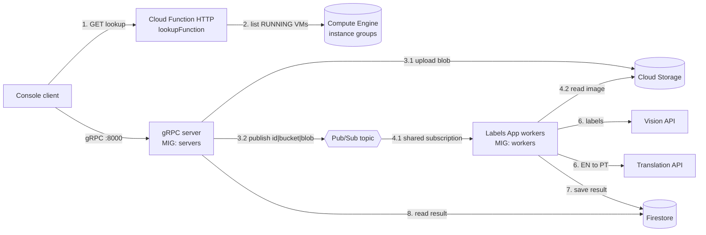

# GCP Media Processor (CN2026Labels)

A distributed and elastic system on **Google Cloud Platform** that detects the visual features (*labels*) of an image, such as `tree`, `street`, `night` or `cat`, and translates them from English to Portuguese.

Clients talk to the system over **gRPC** (including client-streaming image upload). Processing is decoupled through a **Pub/Sub work queue**, so the number of gRPC servers and the number of image-processing workers can be scaled independently, even at runtime through the gRPC API itself.

Built for the *Cloud Computing* course (ISEL, LEIM, 2025/2026) as a three-person team project.

## Architecture



| Component | Role |
|---|---|
| `grpcContract` | Protobuf contract and generated gRPC code (shared by client and server) |
| `grpcServerApp` | gRPC server: receives the image stream, stores it, publishes the job, reads results, resizes instance groups |
| `labelsApp` | Worker: consumes jobs from Pub/Sub, calls Vision and Translation APIs, writes results to Firestore |
| `lookupFunction` | HTTP Cloud Function returning the IPs of running gRPC servers |
| `grpcClientApp` | Interactive console client |

### Why these choices

- **Pub/Sub instead of calling the worker directly.** If no worker is available when a request arrives, the message stays in the subscription until one is. This was tested: an image submitted with the worker group scaled to zero was processed as soon as instances were added. It also allows many workers to consume in parallel (work-queue pattern: each message goes to one worker).
- **Two separate managed instance groups** (servers and workers, from different instance templates), so each layer scales on its own.
- **Firestore** because each request has a variable number of detected labels, which fits a document model better than a fixed relational schema.
- **Synchronous publish.** The server waits for the Pub/Sub acknowledgement before answering the client. With the default asynchronous publisher, an authentication failure made the server reply "success" while the message was never published.
- **Service discovery through a Cloud Function**, because VM IPs change whenever an instance is replaced.

## gRPC contract

```
service FuncionalidadesGerais {
  rpc SubmeterImagem (stream BlocoImagem) returns (RespostaSubmissao);          // upload image, get request id
  rpc ObterDetalhesImagem (PedidoDetalhes) returns (RespostaDetalhes);          // labels + translations + date
  rpc ProcurarPorCaracteristica (PedidoPesquisa) returns (RespostaPesquisa);    // file names by label and date range
}

service GestaoElasticidade {
  rpc EscalarServidoresGrpc (PedidoEscala) returns (RespostaEscala);            // resize gRPC server group
  rpc EscalarLabelsApp (PedidoEscala) returns (RespostaEscala);                 // resize worker group
}
```

The full contract is in `grpcContract/`.

## Data formats

**Pub/Sub message** (plain text, `|`-separated): `<request_id>|<bucket>|<blob_name>`. Blob names are generated by the server (`<uuid>_<original_name>`), so user input never contains the separator.

**Cloud Storage blob:** `<uuid>_<original_file_name>`.

**Firestore**, collection `imagens_processadas`, document id = request UUID:

| Field | Type | Notes |
|---|---|---|
| `dataProcessamento` | string | `YYYY-MM-DD` |
| `nomeBlob` | string | blob name in the bucket |
| `labels_simples` | array of string | English labels, used for `array-contains` queries |
| `caracteristicas_detalhadas` | array of map | `nomeOriginal`, `nomeTraduzido`, `confianca` (0 to 1) |

`labels_simples` is kept next to the detailed list because Firestore can run `array-contains` over strings but not over nested objects. Searching by label **and** date range needs a **composite index** on `labels_simples` + `dataProcessamento`; Firestore prints a link to create it the first time the query runs.

## Elasticity

Two managed instance groups in `europe-southwest1-a` (Madrid), created from different instance templates with startup scripts that launch only the gRPC server or only the worker. Autoscaling is disabled; capacity is changed through `EscalarServidoresGrpc` / `EscalarLabelsApp`, which call the Compute Engine API (`InstanceGroupManagersClient.resizeAsync`).

Storage and Firestore are in `europe-west1`. The compute groups were moved to Madrid after `ZONE_RESOURCE_POOL_EXHAUSTED` errors in Belgium.

## Setup

Prerequisites: JDK 21, Maven, a GCP project, `gcloud`.

1. Enable the APIs: Cloud Storage, Pub/Sub, Firestore, Compute Engine, Cloud Run functions, Cloud Vision, Cloud Translation.
2. Create the resources (names used in the code, change them in the source if you use others):
   - Storage bucket `cn-trabalho-final-bucket-2526`
   - Pub/Sub topic `cn-image-processing` and subscription `cn-labels-App`
   - Firestore database `cn-firestore` (Native mode) plus the composite index above
   - Two instance templates and managed instance groups `grupo-madrid-servidores` and `grupo-madrid-workers` (zone `europe-southwest1-a`)
   - Deploy `lookupFunction` as an HTTP Cloud Run function
3. Create a service account with access to those services and download a key. **Never commit the key.**
4. Build in this order, because the other modules depend on the contract:

```bash
cd grpcContract && mvn clean install
cd ../grpcServerApp && mvn clean package
cd ../labelsApp && mvn clean package
cd ../grpcClientApp && mvn clean package
```

5. Run each component with the credentials in the environment. Note that `sudo` drops environment variables, so set them on the same line:

```bash
GOOGLE_APPLICATION_CREDENTIALS=/path/to/key.json java -jar grpcServerApp/target/<server>.jar
GOOGLE_APPLICATION_CREDENTIALS=/path/to/key.json java -jar labelsApp/target/<worker>.jar
```

6. Run the client. It asks the Cloud Function for the server IPs, lets you pick one (or refresh the list) and shows a menu: submit an image, get details by request id, search by label and dates, scale the servers, scale the workers.

> The Cloud Function URL, project id, bucket, topic and instance group names are hardcoded in the source.

## Issues found along the way

- **gRPC version conflict.** The contract module used gRPC 1.62.2 while the Google Cloud client libraries need 1.76.3, causing `NoSuchMethodError` when authenticating to Pub/Sub. Fixed by upgrading the contract module and doing a clean rebuild of every module (including the jar already deployed on the VMs).
- **Unneeded dependency in the client.** `google-cloud-storage` pulled in incompatible transitive gRPC versions; removing it fixed the same error.
- **Project id in the Cloud Function.** `StorageOptions.getDefaultInstance().getProjectId()` returned `null` in 2nd-generation Cloud Functions, causing HTTP 500; the id is now set explicitly.

## Limitations

- gRPC runs in plaintext with no authentication. **Anyone who can reach port 8000 can also call the scaling operations.** Acceptable for a course project, not for production (needs TLS and authentication).
- No dead-letter queue: a message that fails repeatedly is redelivered indefinitely.
- Results are asynchronous. Querying a request that has not been processed yet returns `NOT_FOUND`; the client has to retry.
- The client keeps one connection for the whole session and does not reconnect automatically if that server dies.
- The optional Pub/Sub-triggered logging Cloud Function was not implemented.
- Configuration is hardcoded instead of read from environment variables.

## Cost warning

This project creates billable resources (VMs, Storage, API calls). Delete the instance groups and templates when you are done. The scaling endpoint has no authentication, so do not leave it running on a public IP.

## Team

Diogo Santiago (51998), Joana Ramos (50829), Martim Ramos (51736). Course: Computação na Nuvem, ISEL, 2025/2026. Lecturer: José Simão. The full report (architecture, protobuf contract, assumptions, failure points) is in `docs/`.
